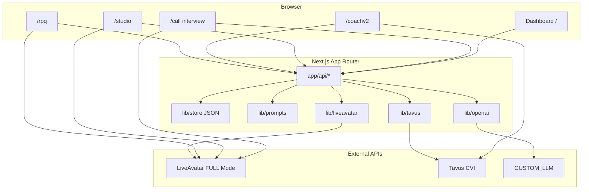
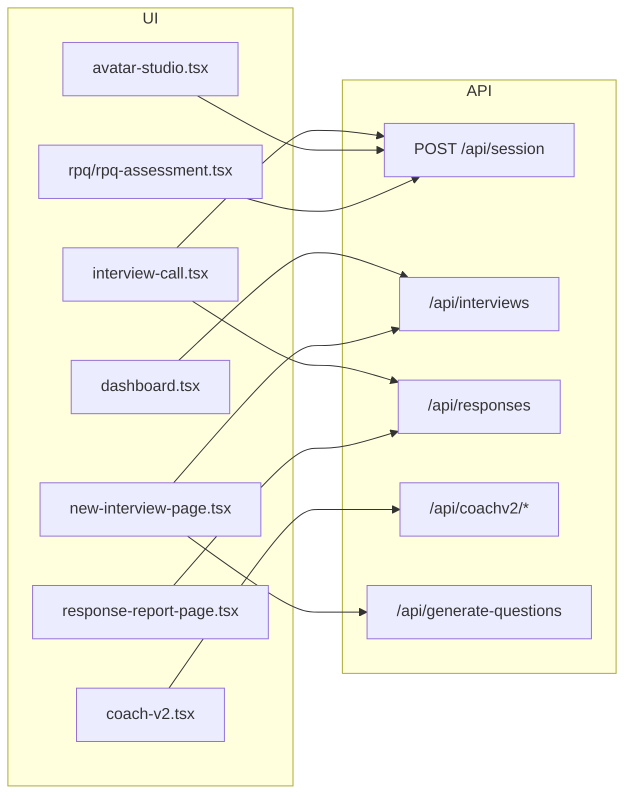
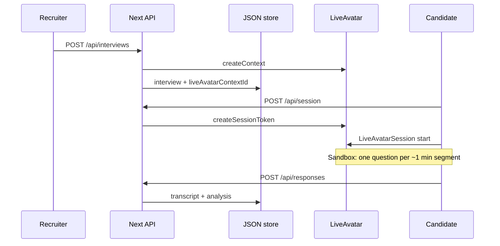
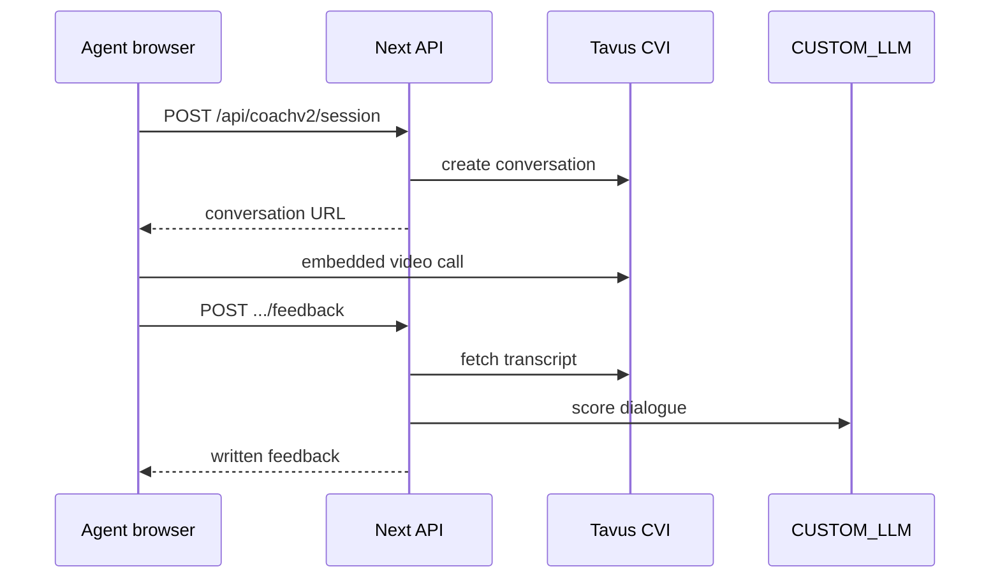

# Capco Avatar Demo

Next.js demos for Capco hiring interviews, insurance coaching, and risk profiling — powered by **LiveAvatar** (HeyGen) and **Tavus** conversational video.

| Product | Path | Provider |
|---------|------|----------|
| Hiring interviews | `/`, `/call/[id]` | LiveAvatar FULL Mode |
| Avatar studio | `/studio` | LiveAvatar |
| Coach v2 (insurance role-play) | `/coachv2` | Tavus CVI |
| Risk Profile Questionnaire | `/rpq` | LiveAvatar |

Local JSON persistence under `data/` (no database). Auth is deferred.

---

## Install

**Requirements:** Node.js 20+, npm, API keys for LiveAvatar and/or Tavus, plus an OpenAI-compatible LLM key for question generation and scoring.

```bash
git clone https://github.com/alancapco/avatardemo.git
cd avatardemo
npm install
cp .env.example .env.local
```

Edit `.env.local` (see [Env](#env)). Then:

```bash
# LiveAvatar (interviews, studio, RPQ)
npm run liveavatar:setup
npm run liveavatar:setup-llm    # optional; custom LLM on LiveAvatar voice
npm run liveavatar:setup-rpq    # once, for the RPQ demo context

# Dev server
npm run dev
```

Open [http://localhost:3000](http://localhost:3000).

```bash
npm run typecheck
npm test
npm run build
```

---

## Env

Copy from [`.env.example`](.env.example):

| Variable | Used by |
|----------|---------|
| `LIVEAVATAR_API_KEY`, `LIVEAVATAR_AVATAR_ID` | Interviews, studio, RPQ |
| `LIVEAVATAR_CONTEXT_ID` | Studio demo context |
| `LIVEAVATAR_RPQ_CONTEXT_ID` | RPQ (from `setup-rpq`) |
| `LIVEAVATAR_SANDBOX` | `true` ≈ 1 min free sessions (segmented interviews/RPQ) |
| `LIVEAVATAR_LLM_*` | Optional custom LLM on LiveAvatar |
| `CUSTOM_LLM_*` | Question gen, interview analysis, Coach feedback |
| `TAVUS_API_KEY`, `TAVUS_PAL_ID`, `TAVUS_FACE_ID` | Coach v2 |

Never commit `.env.local`.

---

## Architecture



### Components



### Data flow — hiring interview



### Data flow — Coach v2



---

## Product flows

### Recruiter (LiveAvatar interviews)

1. **Dashboard** `/` — interviews and averages  
2. **Interviewers** `/interviewers` — AI personas  
3. **New interview** `/interviews/new` — JD → questions → save  
4. **Detail** `/interviews/[id]` — share link, candidates  
5. **Report** `/responses/[id]` — scores, transcript  

### Candidate

1. Open `/call/[interviewId]` → name → start  
2. Speak with the video avatar  
3. End (or finish sandbox segments) → transcript analysed  

With `LIVEAVATAR_SANDBOX=true`, each question is a short session with a continue screen between segments.

### Coach v2 (Tavus)

1. Open `/coachv2`  
2. Pick emotion, brief, language → start role-play as insurance agent  
3. End call → written feedback from transcript + LLM  

### RPQ

`/rpq` — 12-question bilingual assessment, LiveAvatar facilitator, deterministic 12–60 scoring. Sandbox uses four short sessions (3 questions each).

| Score | Band |
|-------|------|
| 12–21 | Conservative |
| 22–30 | Stable |
| 31–40 | Balance |
| 41–50 | Growth |
| 51–60 | Aggressive |

---

## Project layout

```
app/                  App Router pages + API routes
components/           UI (interview, studio, coach, RPQ, dashboard)
lib/
  liveavatar/         LiveAvatar HTTP client
  tavus/              Tavus CVI client
  openai/             CUSTOM_LLM client
  prompts/            Prompt builders
  analysis/           Interview scoring pipeline
  store/              Atomic JSON persistence
  rpq/                RPQ questionnaire + scoring
scripts/              liveavatar:setup* helpers
types/                Shared Zod/types
data/                 Local JSON (gitignored)
```

| Piece | Role |
|-------|------|
| `lib/store/*` | Atomic JSON files |
| `lib/liveavatar/server.ts` | Session tokens + contexts |
| `lib/tavus/server.ts` | PAL + conversations + transcripts |
| `lib/prompts/*` | Interview, Coach, RPQ prompts |
| `components/interview-call.tsx` | Candidate call + sandbox segments |
| `components/coach-v2.tsx` | Tavus coach UI |

---

## Data store

JSON under `data/` (gitignored):

- `interviewers.json`
- `interviews.json`
- `responses.json`
- `rpq-assessments.json`

Default interviewer personas seed on first read.

---

## License

Private Capco demo. Not for production deployment without auth, secrets management, and a proper datastore.
