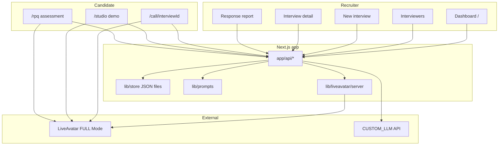
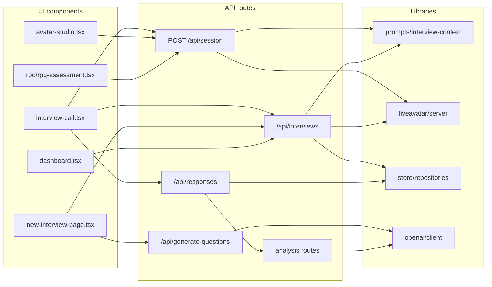
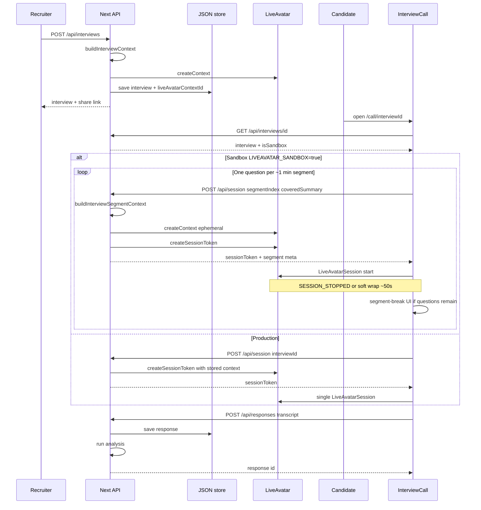

# Capco LiveAvatar Interviews (MVP1)

AI-powered **LiveAvatar video** interviewer platform for hiring. Recruiters create interviews from job descriptions, share candidate links, run full LiveAvatar sessions (realtime video avatar + voice), and review scored insights.

## Features

- Generate tailored interview questions from JD text or PDF
- Multi-persona AI interviewers (empathy, exploration, rapport, speaking speed)
- One-click shareable candidate links
- **LiveAvatar FULL Mode** interviews — video avatar + lip-sync + voice (not phone-only)
- Capco avatar studio demo at `/studio` (your previous Wealth & Asset Management experience)
- Post-call analysis: overall score, question scores, communication metrics, tab-switch tracking
- Dashboard with stats and charts
- Local JSON file store (no Supabase); auth deferred

## Setup

```bash
npm install
cp .env.example .env.local
# Fill LIVEAVATAR_* and CUSTOM_LLM_*
npm run liveavatar:setup
npm run liveavatar:setup-llm   # optional but recommended for voice replies
npm run dev
```

Open `http://localhost:3000`.

## Recruiter flow

1. **Dashboard** `/` — interviews, response counts, averages
2. **Interviewers** `/interviewers` — configure AI personas
3. **New interview** `/interviews/new` — paste/upload JD → generate questions → save
4. **Interview detail** `/interviews/[id]` — copy share link, review candidates
5. **Response report** `/responses/[id]` — scores, communication chart, transcript

## Candidate flow

1. Open `/call/[interviewId]`
2. Enter name → start LiveAvatar interview → allow mic
3. Meet the **video avatar** interviewer (same Capco studio stage as `/studio`)
4. End interview → transcript saved and analysed

With `LIVEAVATAR_SANDBOX=true`, the lobby warns that short pauses may occur. After each ~1-minute segment the candidate continues to the next question; the full transcript is submitted only when the interview finishes (or they end early).

Demo the original avatar anytime at `/studio`.

## Risk Profile Questionnaire demo

`/rpq` is a full LiveAvatar video assessment, with an English-speaking avatar
and bilingual English / Traditional Chinese answer controls. It contains the
approved 12-question RPQ, deterministic 12–60 scoring, and these risk bands:

| Score | Risk tolerance | Investment risk profile |
| --- | --- | --- |
| 12–21 | Low | Conservative |
| 22–30 | Low-Medium | Stable |
| 31–40 | Medium | Balance |
| 41–50 | Medium-High | Growth |
| 51–60 | High | Aggressive |

Start its reusable LiveAvatar context once after adding your API key:

```bash
npm run liveavatar:setup-rpq
```

The assessment shows an education-only disclaimer before start. It collects no
name, email, or contact data. Completed anonymous assessments (including
answers and score) are stored locally in `data/rpq-assessments.json`. This demo
does not provide investment advice; results require review by a qualified
adviser.

Spoken answers are matched against only the visible option IDs. Common answers
and option numbers are handled locally without a model call. The configured
low-cost `CUSTOM_LLM_MODEL` is used only as an optional constrained fallback
for otherwise ambiguous speech.

Run the regression suite with:

```bash
npm test
```

## Data store

JSON files under `data/` (gitignored):

- `interviewers.json`
- `interviews.json`
- `responses.json`
- `feedback.json`

Default interviewer personas seed automatically on first read.

## Architecture

| Piece | Role |
|-------|------|
| `lib/store/*` | Atomic JSON persistence |
| `lib/openai/client.ts` | Question gen + analysis via `CUSTOM_LLM_*` |
| `lib/liveavatar/server.ts` | Session tokens + per-interview contexts |
| `lib/prompts/*` | LLM prompt templates |
| `app/api/*` | REST APIs |
| `components/interview-call.tsx` | Candidate LiveAvatar session + sandbox segments + tab tracking |

On interview create, the API builds a LiveAvatar **context** from the questions + persona and stores `liveAvatarContextId`. Candidate sessions use that context (not the global demo context). When `LIVEAVATAR_SANDBOX=true`, each question runs in a short ephemeral context instead (see sandbox segments below).

### System overview



### Components



### Data flow — interview create and call



### Sandbox duration segments

Free LiveAvatar sandbox sessions last about **one minute**. Interviews and RPQ split work across short sessions so the platform kill does not discard progress:

- **Interviews**: one primary question per segment; transcript accumulates; continue screen between segments; submit once at the end
- **RPQ**: three questions per segment (four sessions total)
- Soft wrap nudge at ~50s; reactive `SESSION_STOPPED` still drives the continue path
- Non-sandbox (`LIVEAVATAR_SANDBOX=false`) keeps a single uninterrupted session

## Env

See [`.env.example`](.env.example). `CUSTOM_LLM_API_KEY` is required for question generation and analysis even if LiveAvatar custom LLM is not registered.
